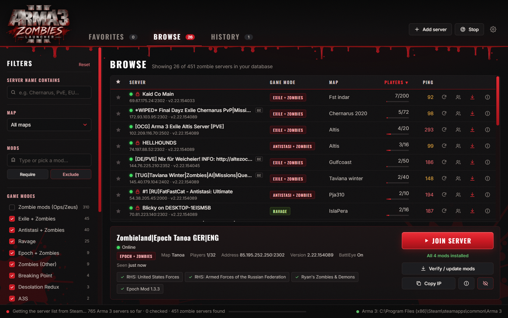

## Download: [⬇ Latest Zombies Launcher (portable .exe)](https://github.com/husky3g/Arma3ZombiesLauncher/releases/latest)
Windows 10/11, 64-bit. Nothing to install: download the `.exe` from the latest release and run it. Steam must be running and Arma 3 installed.



# Arma3ZombiesLauncher
A launcher for Arma 3 zombie survival servers, all-encompassing to include all known zombie mods.

An Arma 3 server browser that only lists **zombie servers**: Exile + Zombies, Breaking Point, Ravage,
Desolation Redux, A3S, DayZ-style, Epoch/Antistasi/Wasteland with zombies, and any other server
running a zombie mod. Regular Exile and other non-zombie servers are filtered out.

## Features
* **Favorites / Browse / History** tabs. Opens on Favorites when you have any, otherwise Browse.
* Every column is sortable: name, game mode, map, players, ping, last played.
* **Filters** (saved between sessions):
  * Name contains.
  * Map: an alphabetical list of discovered and known zombie maps.
  * Mods: require or exclude any mod.
  * Game modes.
  * Show/hide full, password-protected, locked, empty, not-responding and hidden servers.
* **Status dot** on every server: green = online, yellow = locked/restarting, red = offline. A red lock means password protected.
* Row buttons: refresh, player list, download required mods, and **server info**. Server info shows details, the
  required mods with sizes, and the estimated download size to join.
* **Right-click menu**: join, download mods, info, players, refresh, favorite, copy IP, hide/unhide, remove from history.
* **Hide servers** you never want to see. They disappear from every tab unless **Show → Hidden servers** is on.
* **Auto-update**: on launch the portable .exe checks GitHub's latest release, then downloads and verifies the new version
  (size + SHA-256). It updates on **Restart now** or when you close the launcher. You can turn this off in Settings.
* **Donate** button in the status bar (PayPal).

## Run (development)
```
npm install
npm start
```

## Build a portable .exe
```
npm run dist
```

## First run
Nothing to set up. Players only need Steam running (which Arma 3 needs anyway).
1. The launcher finds Arma 3 automatically (registry or Steam libraries). You can change it in **Settings**.
2. It asks the local Steam client for every Arma 3 server, through the player's own `steam_api64.dll` from the
   Arma 3 folder (`src/main/steam-servers-worker.js`, loaded with the koffi FFI). **No Steam Web API key is needed.**
   This runs in a short-lived helper process, so Steam only shows "playing Arma 3" for the few seconds the list takes
   (about 4,000 servers in under a minute).
3. Each server is then queried directly over UDP (A2S_INFO / A2S_RULES / A2S_PLAYER) for its mods, players and ping.
   Zombie servers are kept in a local database, so Browse shows them instantly next time.

## How zombie servers are detected (`src/main/classify.js`)
* Mods the server requires: Ryan's Zombies & Demons, WebKnight's Zombies, Necroplague, Ravage, Desolation Redux, Breaking Point, A3Survival.
* Servers that only have a zombie mod loaded (milsim/Zeus groups) are listed as **Zombie mods (Ops/Zeus)**, hidden by default.
* Server or mission name keywords (zombie, zeds, infected, DayZ, ...).
* Exile, Epoch, Antistasi, Wasteland and Life servers only count when there is zombie evidence.
* Use **Add server** for anything the detector misses, and **Hide server** for anything you don't want listed.

## Data (saved in `%APPDATA%\Zombies Launcher`)
* `servers.json`: the discovered zombie-server database, plus a 24h cache of servers already checked and found not to be zombie servers.
* `catalog.json`: every mod, map and game mode seen, plus cached Workshop mod sizes.
* `state.json`: filters, sort orders, favorites, hidden servers, history and settings.
* `launcher.log`: downloads, launches and scan results, for troubleshooting.

## Joining and mods
* **Join** launches through Steam (`-applaunch 107410 -noLauncher [-useBE]`) with `-connect/-port/-password/-mod`.
  It won't start a second copy while Arma 3 is already running.
* **Download** subscribes to the server's Workshop mods through the Steam client (steamworks.js, run in a
  short-lived helper process) and shows progress. After a download from the Join prompt, the launcher joins automatically.
* Download size estimates come from Steam's public Workshop details endpoint (no key needed).
* Mods that aren't on the Workshop are marked *manual* and are loaded from `@ModName` folders in the Arma 3 directory.
